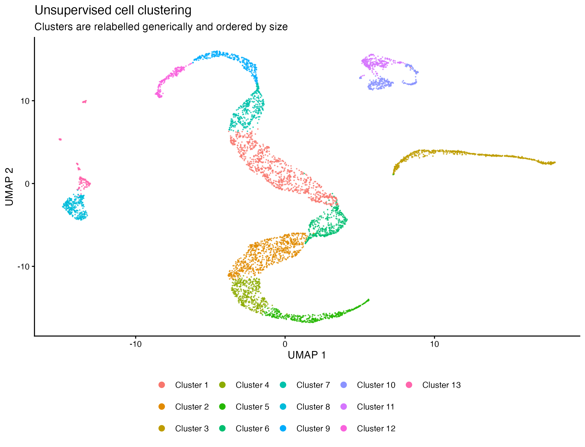
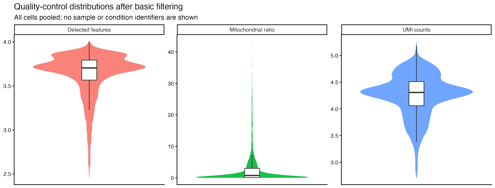
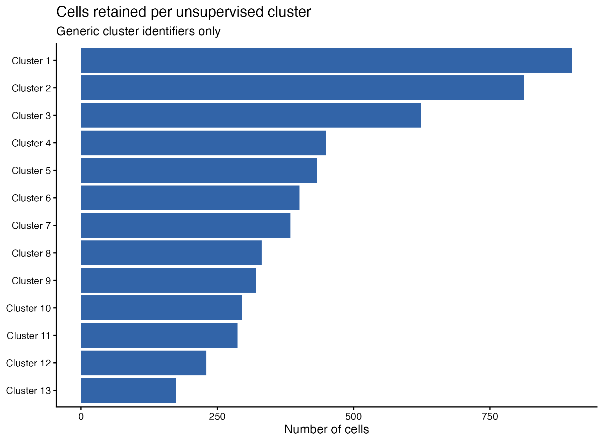

# scRNA-seq workflow — what remains after quality control?

This repository documents a reproducible single-cell RNA-seq analysis with R and Seurat, without CellSweep. The question is deliberately simple: after standard quality control and unsupervised clustering, what structure is present in the cell-level data, and how can that structure be inspected without exposing restricted study information?

> **Privacy-preserving analysis artifact.** No count matrix, BAM/FASTQ file, serialized R object, sample identifier, condition label, gene list, reference object, or per-cell metadata is included. The figures below are approved aggregate views with generic cluster labels only.

## What the analysis produces

The workflow imports processed count matrices, assesses technical quality, optionally estimates nuclear fraction, performs normalization and dimensionality reduction, groups cells without pre-assigned identities, and supports later marker-based annotation and reference transfer.

The repository keeps the code and an example configuration. A local, access-controlled environment is required to run it on the restricted inputs.

## Results snapshot

The three figures below are generated from the filtered analysis object using a privacy-review step that removes study-specific labels before export.

| Unsupervised structure | Quality-control distributions |
|---|---|
|  |  |

**How to read these figures.**

- The UMAP is a low-dimensional map of cells with similar expression profiles placed near one another. It shows **13 algorithmic clusters**, relabelled only as *Cluster 1* to *Cluster 13* and ordered by size. These labels are not biological annotations.
- The QC panels pool all retained cells. They display library size, detected features, and mitochondrial ratio after the first filtering round; no sample, group, or condition is shown.
- The figures are descriptive. They do not establish biological differences, and they must not be used to infer the identity of a sample, condition, or donor.

### Cluster representation



The clusters differ in representation, which is expected in an unsupervised analysis. The plot is intended to make that imbalance visible before any downstream interpretation. It does not disclose the original clustering labels or link any cluster to a sample, group, reference, or cell type.

## Workflow

The complete, annotated workflow is in [analysis/scRNAseq_workflow_sanitized.Rmd](analysis/scRNAseq_workflow_sanitized.Rmd). Its main stages are:

1. **Load local count matrices.** Inputs are read from local relative paths specified in a non-versioned configuration file.
2. **Create Seurat objects and inspect QC.** The notebook calculates count depth, detected features, mitochondrial ratio, and a library-complexity measure.
3. **Estimate nuclear fraction when available.** BAM files are used locally only; neither alignments nor barcode-level measurements are committed.
4. **Normalize and reduce dimensions.** Each library is first assessed separately, then the data are combined for PCA, neighbourhood detection, clustering, and UMAP.
5. **Review markers and QC jointly.** Cluster inspection should combine technical metrics with authorized marker evidence rather than relying on either alone.
6. **Filter and reprocess iteratively.** Exclusions are documented as explicit rules, followed by the same QC and clustering checks.
7. **Optionally transfer labels or analyse subsets.** External references and annotation tables remain local whenever they are restricted.

## Recreate the approved figures

The included rendering script accepts a local Seurat object and creates only the three aggregate, anonymized figures shown above:

```bash
Rscript scripts/render_sanitized_figures.R /secure/path/to/object.rds assets
```

Before committing regenerated figures, review them for direct or indirect identifiers. The script intentionally:

- replaces the original cluster codes with size-ranked generic labels;
- pools cells across all samples and conditions;
- omits sample-level, group-level, marker-level, and reference-level visualizations;
- writes images only, never the source object or tabular cell metadata.

## Use the workflow locally

1. Create a local `data/` directory that is never versioned.
2. Copy [config/example_samples.csv](config/example_samples.csv) to `config/samples.csv`.
3. Fill it with approved local paths and identifiers.
4. Review parameters in the R Markdown notebook, then enable only the chunks needed for the local run.

The notebook defaults to `eval = FALSE`, which prevents accidental execution against private inputs.

## Repository layout

```text
analysis/   Annotated anonymized R Markdown workflow
assets/     Privacy-reviewed aggregate figures shown in this README
config/     Generic sample configuration template
scripts/    Local figure-rendering script with label sanitization
```

## Data protection and limitations

- **Restricted inputs are excluded.** The .gitignore blocks matrices, reads, BAM/CRAM files, R objects, tables, results, and arbitrary rendered outputs.
- **Identifiers are removed.** Original sample, group, condition, cluster, marker, and reference labels are not present in this repository.
- **The figures are not a biological conclusion.** They show technical and unsupervised structure only. Interpretation requires the protected analysis environment and authorized contextual metadata.
- **Thresholds are not universal.** QC filters, dimensionality choices, clustering resolution, and any annotation decision must be justified for each new dataset.
- **No clinical or diagnostic use.** This is a research workflow and not a clinical decision tool.

## Main dependencies

R (>= 4.3), Seurat (v5), tidyverse, patchwork and, for nuclear-fraction calculation, DropletQC and Rsamtools.

## License

Add the license that applies before redistributing the code.

