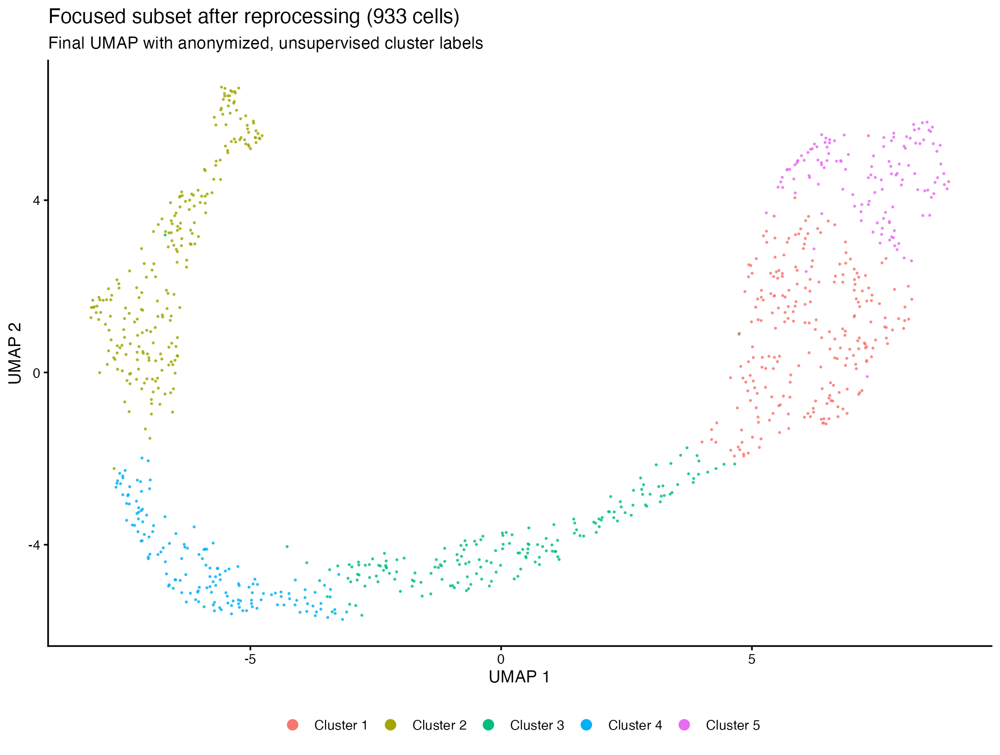
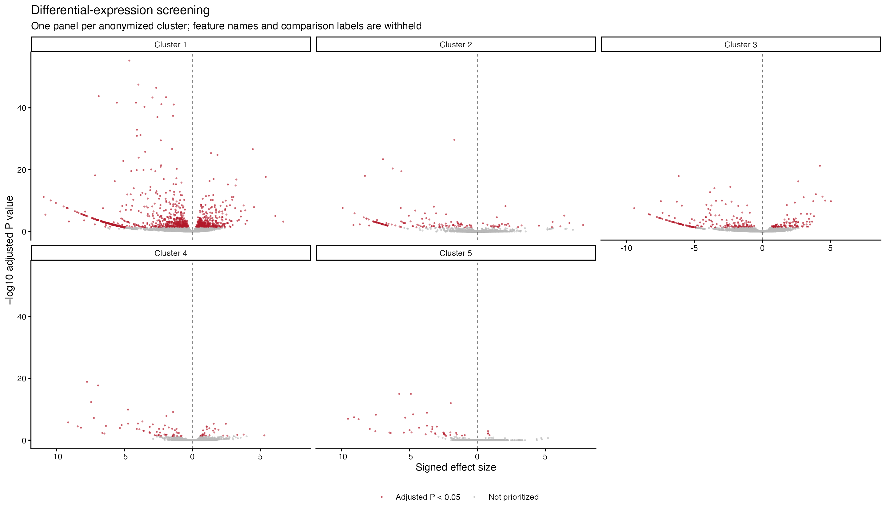
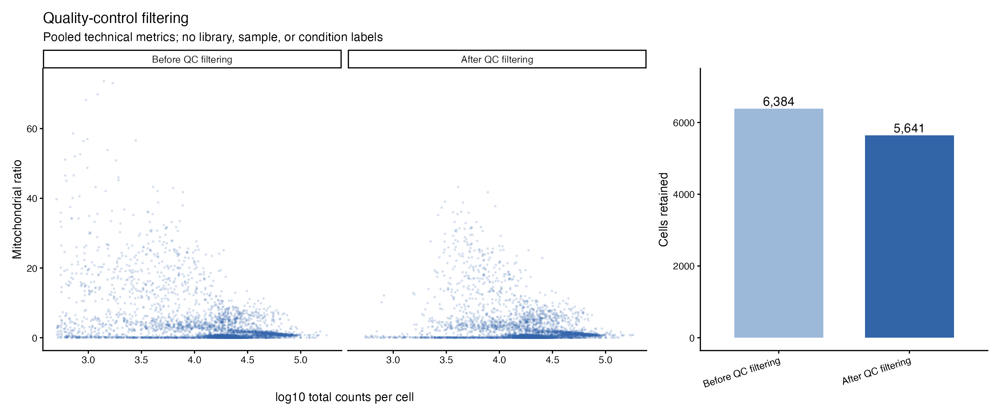
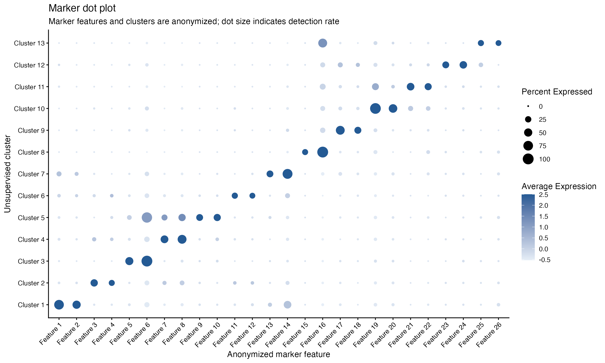
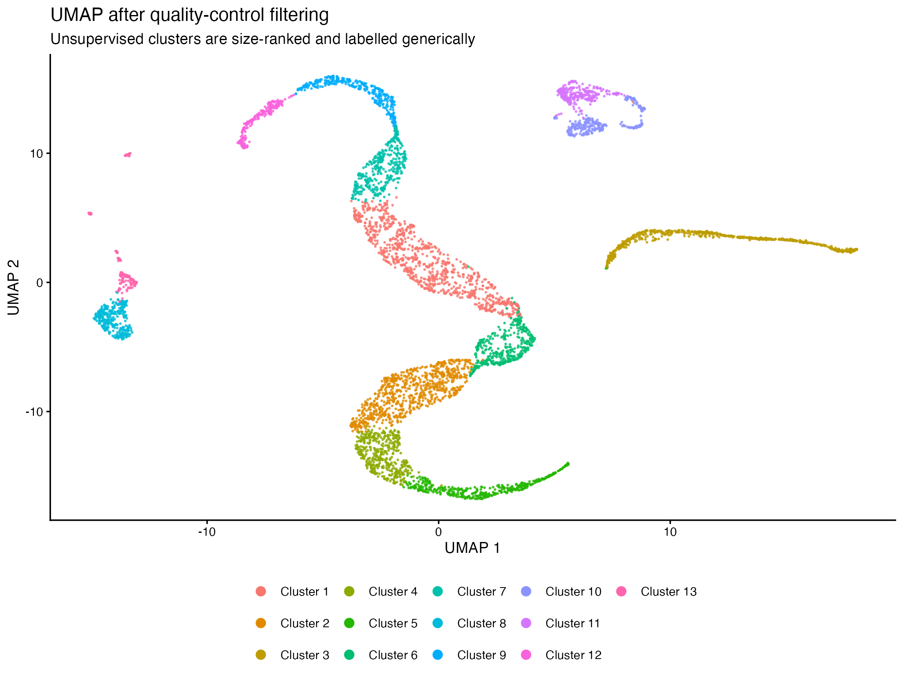

# scRNA-seq – from 6,384 raw cells to a focused population of 933, with Seurat

> **A real analysis, shown without its data.** The study behind it is not published, so this repository shows how I worked rather than what I found. Every gene, cluster, sample and condition in the figures has a generic label.

## What this project is

This is a single-cell RNA-seq analysis I did in R with Seurat, on 10x Genomics data from several samples in two experimental groups. In single-cell data most of the work is deciding which cells to trust and which structure is biology rather than noise, and that is what I want to show here: the decisions at each step, the annotated notebook, and the figures that came out of them.

The questions I worked through are:

1. **Which cells are good enough to keep?**
2. **What structure is left once the technical noise is out?**
3. **Which population matters for the study, and what does it look like on its own?**
4. **Which genes change between the two groups inside that population?**

## The short version

| Question | What I did and found |
|---|---|
| Which cells are good enough to keep? | **5,641 of 6,384 cells (88 %).** I set the cut-offs by looking at every sample's own distributions of genes, UMIs, mitochondrial share and complexity, not by copying thresholds from another study. |
| What structure is left? | After re-processing the clean cells, they form clear clusters, which I characterised with marker genes. |
| Which population matters? | I isolated **933 cells** and re-processed them on their own, so their structure is not dominated by the cells I set aside. |
| What changes between the groups? | I ran a differential-expression screen cluster by cluster inside the subset. The genes and their direction stay private until the study is published. |

## What the analysis gives you

The focused population of 933 cells, and the differential-expression screen inside it:

| Focused 933-cell subset | Differential expression by cluster |
|---|---|
|  |  |

*How to read them.* In the UMAP (left) each dot is a cell, and cells with similar gene activity sit close together; the colours are the clusters. In each volcano plot (right) each dot is a gene: the further to the left or right, the bigger the change between the two groups, and the higher, the more confident the test.

## Following the analysis step by step

<b>Show the five steps</b> (quality control, markers, the clean dataset, the focused subset, differential expression)

### 1. Quality control

For every cell I computed the number of genes and UMIs, the share of mitochondrial reads (a sign of damaged or dying cells) and a complexity score (genes per UMI, which drops in low-quality droplets). The notebook also has an optional step to estimate the nuclear fraction from the BAM files with DropletQC. I first normalised each sample on its own to spot technical problems in a single library, then looked at the distributions sample by sample before choosing the cut-offs. Going from 6,384 to 5,641 cells:

### 2. Markers

After merging the samples I normalised, ran PCA and clustered at several resolutions, choosing the number of components and the resolution from diagnostic plots. I then looked for the genes that set each cluster apart (`FindAllMarkers`). The dot plot keeps the logic of the original (colour for average expression, dot size for the share of cells that express the gene), with every gene and cluster renamed:

### 3. The clean dataset

Filtering was iterative: after each round I re-ran normalisation, PCA, clustering and UMAP, and checked again the QC metrics, the markers and how the cells of each sample spread across the clusters, so that no cluster was explained by a single library. This is the dataset after quality control:

### 4. The focused subset

I then selected the population relevant to the study, 933 cells, and processed it again from scratch (normalisation, variable genes, PCA, clustering and UMAP). Re-processing a subset matters: the variable genes and principal components of the full dataset are chosen to separate very different cell types, and they can hide the finer structure inside one population.

### 5. Differential expression

Inside the subset I compared the two experimental groups cluster by cluster. Each panel is one cluster; the identity of the genes and of the groups is left out on purpose.

## Things to keep in mind

- **No data are included.** The repository has no count matrices, sequencing files, R objects, sample names, conditions, gene names or cell-level tables, and the [.gitignore](.gitignore) keeps them out. The figures are aggregate views with generic labels.
- **The figures show the method, not a result.** Without the gene names and the groups they cannot be read as a biological conclusion, and the interpretation of the study belongs to the study itself.
- **The notebook cannot be re-run from this repository.** It needs the original data, and several steps (the clusters removed in each round, the marker panel, the reference for label transfer) are left as documented placeholders.

## Try it yourself

The full, annotated analysis is in [analysis/scRNAseq_workflow_sanitized.Rmd](analysis/scRNAseq_workflow_sanitized.Rmd). It works as a template for your own 10x data:

1. Copy `config/example_samples.csv` to `config/samples.csv` and fill in your samples, groups and paths.
2. Put the count matrices (and, for the nuclear fraction, the BAM files) in `data/`, which Git ignores.
3. Open the notebook in RStudio and run it chunk by chunk, making each decision on your own data.

[scripts/render_sanitized_figures.R](scripts/render_sanitized_figures.R) is the script I used to make the anonymised figures from the local Seurat objects.

## Built with

R (≥ 4.3), Seurat (v5), tidyverse, patchwork and, for the nuclear fraction, DropletQC and Rsamtools.

## Author

Tiago Alejo Herrador. No licence has been chosen yet, so please ask before reusing the code.
